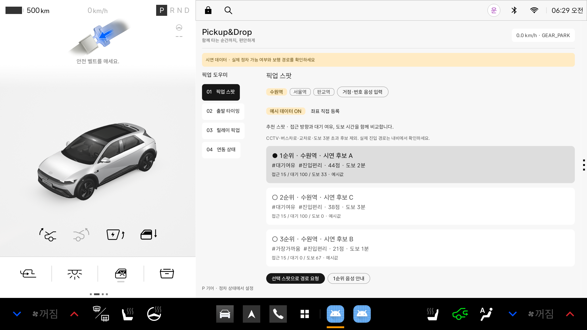

# Pickup&Drop

운전자와 동승자의 픽업 장소·도착 예정 시간·탑승 순서를 맞추는 Pleos Connect 차량용 앱입니다.

## 화면 예시



Pleos Connect v2.1.0 / Android API 34 / 2560×1440 에뮬레이터에서 직접 실행해 캡처한 주간 모드 화면입니다. P 기어·속도 0 상태이며, 표시된 추천 후보는 시연 데이터입니다.

## 실행 방법

1. Android Studio에서 저장소 루트 폴더를 엽니다.
2. Android SDK Platform 35와 Pleos Connect 에뮬레이터를 설치하고, `local.properties`의 `sdk.dir`을 본인의 Android SDK 경로로 설정합니다.
3. Gradle JDK는 JDK 17로 설정하고 Gradle Sync를 실행합니다. 최초 의존성 다운로드에는 인터넷 연결이 필요합니다.
4. Pleos Connect 에뮬레이터를 실행하고 Android Studio에서 `app` 실행 구성을 선택해 설치·실행합니다.
5. 차량 신호가 정상 수신되는 P 기어·속도 0 상태에서 거점을 선택하고, 동승자와 목적지를 설정한 뒤 경로를 요청합니다. 표시된 ETA와 권장 외출 시각을 확인하고 픽업 안내를 공유합니다.

명령줄에서 디버그 빌드 및 실행:

```powershell
.\gradlew.bat :app:assembleDebug
adb install -r app/build/outputs/apk/debug/app-debug.apk
adb shell am start -n com.example.pickupdrop/.MainActivity
```

ADB가 PATH에 없다면 Android SDK의 `platform-tools/adb.exe`를 사용합니다. 여러 기기가 연결되어 있으면 `adb -s <기기 시리얼>`로 대상을 지정합니다.

## 테스트 환경 및 필요한 설정

| 항목 | 설정 |
| --- | --- |
| 앱 이름 / 패키지 | Pickup&Drop / `com.example.pickupdrop` |
| 개발 언어 / UI | Kotlin 2.0.21 / Jetpack Compose |
| Android SDK | minSdk 28 / compileSdk 35 / targetSdk 35 |
| Android Gradle Plugin | 8.7.3 |
| Gradle Wrapper | 8.9 |
| 내비게이션 SDK | NaviHelper 3.0.5 |
| Pleos Connect 에뮬레이터 | v2.1.0 — 로컬 AVD 표시 이름 기준 |
| 에뮬레이터 시스템 이미지 | Android API 34 / `pleos_car_emulator` / x86_64 |
| 화면 규격 | 가로 2560 × 세로 1440 px / 160 dpi |

- 위 에뮬레이터 정보는 로컬 AVD 설정에서 확인했습니다. 최종 시연·제출에 다른 환경을 사용하면 해당 값으로 갱신해야 합니다.
- Pleos 내비게이션 서비스와 차량 속도·기어 신호가 필요합니다. 유효한 P 기어·정차 신호가 없으면 편집·경로 변경·공유가 제한됩니다.
- 앱에서 요청하는 차량 속도 권한을 허용합니다. 음성 입력을 사용할 때는 마이크 권한도 허용합니다.
- 음성 기능에는 한국어 TTS 엔진과 한국어 온디바이스 음성 인식 지원이 필요합니다. 미지원 환경에서는 화면 버튼을 사용합니다.
- NaviHelper 의존성은 `settings.gradle.kts`에 등록된 Pleos Maven 저장소에서 받습니다.
- 이름 변경 후 패키지 ID가 변경되어 이전 앱과 별도로 설치되며, 이전 앱의 저장 데이터는 자동 이전되지 않습니다.

### 빌드·화면 검증 상태 (2026-11-15)

- Gradle Wrapper를 8.9로 조정하고 JDK 17.0.21에서 `:app:assembleDebug` 빌드 성공을 확인했습니다. Windows 실행 스크립트가 프로젝트 폴더명의 `&`를 처리하도록 경로 대입을 수정했습니다.
- 생성된 APK의 앱 이름은 `Pickup&Drop`, 패키지는 `com.example.pickupdrop`입니다.
- Pleos Connect v2.1.0 / API 34 에뮬레이터에 APK를 설치하고 실행했습니다. 차량 속도 0 및 P 기어, Pleos 내비 연결 상태를 확인했습니다.
- 주간 모드의 픽업 스팟·출발 타이밍·릴레이 픽업·연동 상태 메뉴, 야간 모드, 좌표 등록 팝업을 실제 화면으로 확인했습니다.
- 화면 밀도를 일시적으로 320dpi로 변경해 좁은 dp 영역에서 가로 메뉴 전환과 콘텐츠 스크롤을 확인한 뒤, 기본 160dpi 및 주간 모드로 복원했습니다.
- 초기 차량 신호 미확인 상태에서 조작 잠금 화면을 확인했습니다. 실제 D/R 전환 및 주행·도착·연속 탑승 시나리오는 이번 화면 검증에 포함되지 않습니다.
- debug 빌드 및 제출용 서명 release APK의 빌드·설치·실행을 모두 확인했습니다. 제출 파일은 아래 APK 파일 위치에 안내한 release APK입니다.

## APK 파일 위치

**팀명: PAL223 · 앱 이름: Pickup&Drop · 버전: 0.2 (versionCode 2)**

[제출용 서명 release APK 다운로드](apk/PAL223_Pickup%26Drop_release.apk)

```text
apk/PAL223_Pickup&Drop_release.apk
```

- `:app:assembleRelease` 및 release 필수 Lint 검사 통과 후 전용 release 키로 서명했습니다.
- APK 서명 검증 및 16KB 페이지 정렬 검사를 통과했습니다. 디버그 모드는 비활성화되어 있습니다.
- Pleos Connect v2.1.0 / Android API 34 에뮬레이터에서 서명된 release APK의 설치·실행 및 픽업 스팟 화면을 확인했습니다.
- 파일 크기: 19,118,334 bytes (약 18.2 MiB).
- 서명 키와 암호는 저장소에 포함하지 않습니다. 이후 업데이트도 같은 키를 사용해야 합니다.

SHA-256:

```text
db5e0895580a893f45ec9ebddecc8179ca3b78eb3f87576c707a4c6f7e414455
```

위 APK 파일을 소스 코드와 함께 저장소에 업로드하고, 접수 메일에 저장소 주소와 최종 커밋 해시를 기재합니다. 제출 기준은 [공식 지원·제출 방법](https://appdevchallenge.auto-hmg.io/guide/submission#files)을 참고하세요.

## UI 디자인

[Pleos Connect UI Design Guide](https://document.pleos.ai/docs/connect/guide/docs-design/Introduction/intro)의 가독성·명확한 정보 위계·주야간 모드·화면 크기 대응 원칙을 참고해 Compose UI를 구성했습니다. 공식 Pleos UI SDK 컴포넌트나 인증된 디자인 토큰을 가져온 구현은 아닙니다.

- 시스템 주야간 설정에 따라 밝은 테마와 어두운 테마 전환
- 앱 영역 너비 1000dp 이상에서 왼쪽 메뉴와 오른쪽 콘텐츠, 좁은 영역에서 가로 스크롤 메뉴
- 20~36sp 글자 위계와 최소 64dp Material 조작 영역, 72dp 메뉴
- 선택한 픽업 스팟 강조 및 경로 요청·취소 대기 상태 표시
- 주행 또는 차량 신호 미확인 상태의 편집 잠금 유지

UI 변경 후 debug 및 release 빌드와 에뮬레이터 시각 검증을 완료했습니다. 구체적인 환경과 검증 범위는 위의 빌드·화면 검증 상태를 참고하세요.

## 구현

- 후보지: CCTV·버스전용차로·교차로 및 3분 초과 도보 후보 제외, 접근 방향 50% / 대기 여유 30% / 도보 20% 점수. P·정차에서 상위 3개 비교, 좌표 직접 입력. 주행 또는 신호 불명일 때 단일 카드와 안내만 허용.
- JIT: 실제 내비게이션 경유지별 ETA에서 도보 시간과 30초 여유를 빼 외출 시각 계산. 스팟명·지도 링크·도보 안내·시간을 Android 공유 카드로 생성. 공유된 외부 메시지는 자동 갱신하지 않으며 변경 시 다시 공유해야 합니다.
- 최대 3인: 제1·제2 경유지와 최종 목적지를 한 번에 요청. 순서 변경·제거 및 로컬 복원. 현재 동승자 도착 후 P·정차 상태에서 탑승 완료를 눌러 다음 안내 활성화.
- 안전: 속도와 기어의 유효 응답 수신 후 6초 이내, P 기어, |속도| <= 0.01 m/s일 때만 편집·경로·공유·탑승 확인 허용. 차 신호 조회는 백그라운드로 실행. ETA는 15초 만료.
- 정합성: 최종 목적지 좌표 30m 이내 대조. 경유지 좌표가 제공되면 좌표 대조, 에뮬레이터가 0,0으로 반환하면 이름과 순서 대조. 현재 차량 위치나 도착 여부를 임의로 만들어 표시하지 않습니다.
- 음성: Android 시스템 한국어 TTS 및 온디바이스 SpeechRecognizer. 수원역·서울역·판교역 거점 발화와 번호 선택. 엔진이 없는 기기는 버튼 사용. Pleos 음성 SDK를 사용한 것으로 표시하지 않습니다. 주행 중 음성으로도 경로 변경은 차단합니다.

## 데이터 범위

기본 후보는 명시적으로 표시된 시연 데이터입니다. 실제 단속·차로·교차로·정차 적법성 데이터 공급원은 연결되지 않았습니다. 실사용 후보는 사용자가 현장 확인한 좌표와 규제 제외 여부를 직접 입력합니다. 방향 점수는 차량 방향과 후보 방위각의 근사치이며 도로 연결·유턴 횟수의 실제 경로 계산이 아닙니다. 도보 시간 역시 입력값이며 보행 경로 API 결과가 아닙니다. 음성 거점 탐색은 세 거점에 한정되며 자유 POI 검색은 아닙니다.

## 기존 개발 단계 확인 기록 (2026-11-15, 이름·패키지 변경 전)

- Android Studio Gradle 빌드 및 Pleos Connect API 34 설치·실행 확인.
- P 기어·속도 0 신호, 실제 내비게이션 목적지/경유지 요청, 경유지 2개 포함 지도 경로, 3인 저장 복원 확인.
- 실제 경유지 ETA 및 도보+30초를 뺀 권장 외출 시각 표시 확인.
- 순수 정책 로직 14개 검사 통과: 후보 제외, 주행 방향 점수, 신호 만료·NaN·P/R, ETA 만료·시간 역산, 순서·좌표 검증, 릴레이 인덱스, 음성 파싱.
- 전체 주행·실제 경유지 도착·연속 탑승 완료, D/R 전환 UI, 권한 거부·서비스 단절 복구, 음성 엔진 동작은 추가 통합 시험이 필요합니다. 차량 운행용 인증을 의미하지 않습니다.

## 공식 참고

- https://document.pleos.ai/docs/pleos-only/connect-sdk-pleos/NaviHelper/importing-sdk
- https://document.pleos.ai/docs/pleos-only/connect-sdk-pleos/NaviHelper/destinations
- https://document.pleos.ai/en/docs/pleos-only/connect-sdk-pleos/NaviHelper/route-with-waypoints
- https://document.pleos.ai/docs/pleos-only/connect-sdk-pleos/NaviHelper/event-listeners
- https://document.pleos.ai/docs/pleos-only/vehicle-app-developer-guide/vehicle-app-faq
